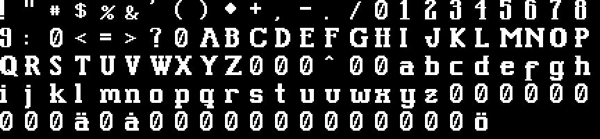
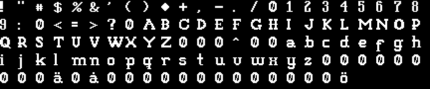

# MDP (Future Crew, 1993) - screens, effects and tricks

*MDP* ("MusicDiscPlayer") is not a demo with a timeline but the S3M/MOD player and menu that Future Crew shipped with their music disks (Purple Motion's *Journey I* and
*II*, Skaven's *Chaotic Mind*; v1.0 for the first two, v1.1 adds `+`/`-` volume and `S` mono/stereo). It is a Turbo Pascal 6/7 program on STMIK 0.9 (SB / SB Pro / GUS
sound), plus two assembly units for the graphics. So this document covers three things: the **menu**, the **playing screen** and what the port does about the **sound**.
The reverse-engineering notes are in [`docs/ANALYSIS.md`](docs/ANALYSIS.md), the asm excerpts in [`WRITEUP-asm.md`](WRITEUP-asm.md).

## 0. What is exact, what is not

| part | status |
|---|---|
| Menu (layout, glyph placement, scroll, selection bar, fade) | ported routine by routine from unit `0x314`; compared with the original code running under Unicorn on a planar VGA model (`tools/oracle.py`, `tools/tests/menu_vs_oracle.mjs`) on every vsync: the write-up page reports all 455 frames of a scripted run identical, planes, CRTC and DAC. The v1.1 menu matches DOSBox-X captures (0 differing pixels, per the README). Only the v1.0 menu is checked against the oracle. |
| Playing screen, static parts (header, labels, grid, bar frame) | match DOSBox-X captures (`tools/tests/play_static.mjs`, 0 differing pixels per the README) |
| Playing screen, moving markers | **approximated**: the maths of the original (quantiser, size, decay) is ported, but the input is rebuilt from pattern data (section 3) and the pitch mapping is shifted. Not compared with the original frame by frame. |
| Progress bar and positions | come from libopenmpt, not from STMIK |
| Sound | **not original**: libopenmpt (WebAssembly) instead of STMIK's mixer |
| Launcher, mouse, CRT overlay, upload of your own modules | additions, not in the original |

## 1. Display

* **BIOS mode 12h: 640x480, 16 colours, 4 planar bit planes**, A000 segment, 80 bytes per row on the playing screen, 64 on the menu. These pixels *are* square (640x480 is
  already 4:3), unlike the 13h demos; the canvas is simply 640x480 scaled by a whole-number factor then smoothed (`Screen.layout` in `site/js/app.js`).
* The port models only what the code touches (`site/js/vga.js`): four 64 KB planes, CRTC start address / line compare / offset, a 16-entry 6-bit DAC, and a
  scan-out that walks the planes. 59.94 Hz frames drive `vsync()`, which the ported routines `await` where the original polled the retrace bit.
* **A colour is a plane.** Nothing in the code writes "colour 5". The text engine sets the sequencer map mask and the graphics-controller read map to one plane
  and ORs the glyph bits into it, so colour *n* of a glyph = "bits only in plane n". The palette (a 16x3 table) is designed for that: entries with a single bit set are the
  text colours, and entry 15 (all planes) is the highlight. See `WRITEUP-asm.md` sections 1-2. The playing screen's `erase` variant (`466d`, `blit(..., erase=true)`)
  clears glyph bits instead of setting them, so text is drawn as "holes" in an all-ones background.

## 2. The menu (unit 0x314, entry 4e1c; `site/js/menu.js`)

**Data.** `MDP.MDI` is a plain text file. A line starting with `#` begins an entry, the first line after it is the file name; a doubled `##` introduces the closing text. The
header lines (`@JOURNEY I@`, `by`, ...) are centred. `@` inside a line toggles bit 0 of the colour, so `@Purple Motion@` flips to the next colour for a
word. Entry bodies: line 1 = the module name (small font), line 2 = a right-aligned year, then body text; a line starting with `$` is justified.

```js
// menu.js: loadMdi - '#' ends the previous text and starts an entry, '##' starts the footer
for (let bx = 0x800; bx < di; bx++) {
  if (b[bx] !== 0x23) continue;
  b[bx] = 0;                                   // make every entry a 0-terminated string
  if (count >= 50 || (b[++bx] === 0x23)) { this.lastWords = bx + 1; bx++; continue; }
  this.ent[count++] = bx;
}
```

The file is copied to offset 0x800 of a 0x2800-byte buffer (at most 0x2000 bytes), up to 50 entries.

**Glyph engine.** Fonts are small tables: a header (`+0` height, `+2` first char, `+4` last char, `+6` default advance) then 4 bytes per character (bitmap offset,
advance); a bitmap is one 16-bit word per row, bit 15 on the left. There are two fonts, A (small, 0x28ac) and B (big, 0x369c), both extracted into
`assets/menu_data.bin` and addressed with their original cs offsets. `drawChar` places a glyph at pixel x with a shift of `x & 7`, 3 bytes per row; with
`shadow` on (menu only), a second pass draws the same glyph into plane 3, 2 pixels right and 2 rows down:

```js
// text.js
const v = (u16(d, g + 2 * r) << 8) >> cl;                       // glyph row shifted into 3 bytes
pl[di] |= v >> 16 & 255;  pl[di+1] |= v >> 8 & 255;  pl[di+2] |= v & 255;
...
if (this.shadow) { let c2 = cl + 2, d2 = di; if (c2 & 8) d2++;
  this.blit(this.vga.planes[3], g, h, (d2 + 2 * this.stride) & 0xffff, c2 & 7, false); }
```

Text layout is a per-line state machine with five modes (plain `463c`, centred `45a0`, right `45b3`, justified `45c3`, and the `@`-toggle in `drawChar`). A justified
line measures its width, takes the slack to 504 px (0x1f8) and gives each space `slack / spacesLeft` extra pixels in turn (asm section 7), so the right margin is flush
without drift. Lines outside the visible band (`clipLo..clipHi`) are measured but not drawn, which keeps the page redraw cheap.

**The page is a 512x1024 virtual screen.** Menu text is drawn into video memory at pitch 64 bytes (512 px) over 1024 rows; the visible window is 480 lines of it,
chosen by the CRTC start address. Only the entries near the window are drawn: `drawPage` redraws everything but only draws rows inside the clip band, `scrollBy`
extends the band by 512 rows on the side one is scrolling towards. The selection is a bar of plane-2 bits (`fillRows(rect0, rect1, 0xff)`) behind the current entry,
erased with `0` before the next scroll. Because the window can run past the end of video memory, the line-compare register restarts the display at address 0:

```js
// menu.js setScroll (4d95)
this.vga.start = ((ax & 0x3ff) * 0x40) & 0xffff;        // CRTC 0Ch/0Dh
await this.env.vsync();
let cx = 0x3ff - (ax & 0x3ff); if (cx >= 0x1e0) cx = 0x1e0;
this.vga.lc = cx;                                        // CRTC 18h (+ bits in 07h, 09h)
```

and `scanout` reproduces it: `a = L <= lc ? start + L*stride : (L - lc - 1)*stride`.

**Scrolling speed.** `scrollBy` moves the target entry to 200 rows below the top (`tgt = rect0 - 0xc8`) and steps `bp` pixels per frame, with `bp` growing by 1 before the half-way
point and shrinking after it, clamped to 1..16: a symmetric ease-in/out with no table.

**Fades.** The screen is drawn with the DAC at zero, then `fade(0, 4)` raises a brightness `al` from 0 to 0x40 by 4 per frame, writing `pal * al >> 6` to the DAC; exit
runs `fade(0x3f, -4)`.

**What the port changes.** Mouse wheel, click-to-select and click-to-play call the same `scrollBy` / key codes; the keyboard handling is the original's (scancode words).
These are additions in the event loop only.

## 3. The playing screen (main program + unit 0xf4e; `site/js/play.js`)

The screen (set up at `f4e:0008`, then the header/labels from the Pascal side, `0:2246`) has:

* a title and four help lines at the top (`ESC for menu`, `F10 for dos`, ...), small and big font, drawn with the erase variant of the glyph engine;
* a 128-pixel progress bar with an 8-pixel-high frame (`bar(v)`, ported from `0:20ba`) built from plane writes, whose fill is one byte per 8 pixels plus a partial byte;
* the numeric panel (`numbers`, `0:2545..2690`: a 32x49 pixel block at x=592 cleared then `: n` drawn at x=580; 65 rows on v1.1 for the extra volume line);
* the **note grid and markers**, the only animated part.

**Grid.** 39 vertical lines (`mov cx, 0x27`), one per column boundary, drawn in plane 3 only with 1-pixel stems and 3-pixel ticks every octave-ish interval (the tick rows are
taken from the displacements of the unrolled stores, `GRID_TICK`). There are 38 columns of markers.

**Markers.** Each marker is 16 pixels wide and 2 rows high per size unit. Per module row change, `scan` goes through the 16 channels and updates a column:

```js
// play.js scan(): per channel
let col = c.inst & 0xff; col--; while (col >= NCOL) col -= NCOL;   // column = (instrument-1) mod 38
...
const y = 0x186 - ((12 * cl + ch + PITCH_SHIFT) << 2);            // 4 px per semitone, 12 per octave
const size = (c.vol >> 3) + 3;
if (this.mSize[col] > size) continue;                              // louder marker wins
this.mY[col] = y; this.mSize[col] = size;
this.mHold[col] = c.loop ? 10 : 0;                                 // looped samples stay up 10 frames
```

So **the column identifies the instrument, the height the pitch, the height of the bar the volume**. Every frame `markers` erases each old marker (20 rows), clamps the new `y` to
[6, 0x186], draws the bar in the plane mask given by the column (`COLS` = 1,2,3,4,5,6,7,6,5,4,3,2, i.e. a colour cycle of period 12 across the columns) and then decays: `hold`
counts down, and at 0 the `size` drops by one per frame until it disappears. The pitch is quantised by the original's chain of compares (asm section 8, including a wrong constant
kept on purpose in `THR`).

What is **original** here: the quantiser, the size formula, the hold/decay rule, the 38-column modulus, the colour table. What is **not**:

* STMIK exposed per-channel state (volume, period, loop end, instrument) in a record the original reads directly (`es:[si+0x12]` period, `+0x1a` volume, `+0x4c` loop end,
  `+0x37` instrument). The port has no STMIK, so `site/js/tracker.js` re-derives that state from the module's pattern data one row at a time: note -> period via the
  semitone table and the sample's C2SPD (S3M: `16*8363*16*T[semi] / (c2spd * 2^oct)`; the factor 16 matches the original's pitch scale, noted in `docs/ANALYSIS.md`), sample volume, volume
  column, note cut. **Slides, vibrato and most effects are not followed**, so markers do not wobble the way the original's did, and the original's extra skip for a non-looping channel
  (`es:[si+0x32] > 0xfa`) is not modelled (its meaning was not worked out).
* **Pitch range.** The original maps periods only upward (`while ax < 0x38a0: ax*=2, cl++`), so very low notes pile up on the bottom row. The port adds the opposite loop
  (`while ax >= 0x7140: ax/=2; cl--`) and shifts everything by `PITCH_SHIFT = 36` semitones to centre typical music. The README states this: "markers are shifted up 3 octaves".
* For module formats other than S3M/MOD (the "your own music" feature), markers come from libopenmpt's pattern data and are cruder still (generic note/volume cells only).

## 4. Sound

The original sound is STMIK's software mixer (or GUS hardware mixing). The port does **not** reproduce it. `site/js/mdp.worklet.js` runs libopenmpt in an AudioWorklet in two modes:

* **Hi-fi**: windowed-sinc interpolation, native sample rate, 32-bit float;
* **Old-school**: nearest-neighbour mixing at 22.05 kHz, 8-bit, sample-and-hold output, "close to a Sound Blaster Pro" (the README's words; no measurement against STMIK is claimed).

Pause and seek (module position: `set_position_seconds` / `set_position_order_row`) are handled in the worklet; the screen reads back order/row/seconds and the marker tracker is
advanced from the pattern data for the new position. Because the original screen is driven only by module state and not by a separate clock, the same structure is kept here.

## 5. Not covered

STMIK itself and the Pascal main program (apart from the two routines named above) were not disassembled in this repository, so nothing is claimed about the player's timing
or the exact moment it samples channel state beyond what the ported code does.

## 6. Art assets: fonts and palettes (there is no bitmap, texture, sprite or 3D art)

MDP has no cover image, texture, sprite or mesh: everything on screen is text, filled rectangles and plane writes. The only art is two bitmap fonts and the palettes. All of it is
verified from `site/assets/menu_data.bin` (6840 bytes = the unit-0x314 data from cs offset 0x28ac to 0x4364, byte-identical to `work/MDP10_unpacked.EXE` at file offset
0x600 + 0x3140 + 0x28ac; the port addresses it by the original cs offsets).

| asset | where | format | size |
|---|---|---|---|
| font A (small) | cs 0x28ac | header `+0` height (18), `+2` first char (33), `+4` last char (148), `+6` default advance (10); then 4 bytes per char (bitmap offset from the font start, advance); bitmap = one 16-bit word per row, bit 15 = left | 1 bit/pixel, glyphs up to 16 px wide, 116 entries |
| font B (big) | cs 0x369c | same layout; height 16, first 33, last 148, default advance 9 | 116 entries |
| menu palette | cs 0x4334 | 16 entries x 3 bytes, 6-bit VGA DAC values, scaled by the fade | 16 colours |
| playing-screen palette | unit 0xf4e, offset 0x48 (copied to `PAL` in `play.js`) | 16 x 3, 6-bit DAC | 16 colours |

Both fonts are 1-bit and single-colour: a glyph takes its colour from the plane it is OR-ed into (section 1), so "number of colours per glyph" is 1 (plus the plane-3 shadow in the menu).
Every code from 33 to 148 has an entry; in the previews, several entries are placeholder shapes (a "0"-like box) for characters the discs do not use, and the accented
letters are present (e.g. a-umlaut, o-umlaut). I decoded them with a 20-line script reading exactly the layout above (the same as `TextEngine.drawChar`); how the fonts were
first found is in `docs/ANALYSIS.md` (header layout, 'G' of the big font at unpacked-file offset 0x66f8).




*Figures: all 116 entries of each font, 2x enlarged, white on black (`figures/font_small.png`, `figures/font_big.png`). `figures/palettes.png`: the 16 entries of the menu palette (top row) and playing-screen palette (bottom row).*


The module files (`*.S3M`, `MDP.MDI`) are the discs' music and text, not art; the discs ship no pictures.
